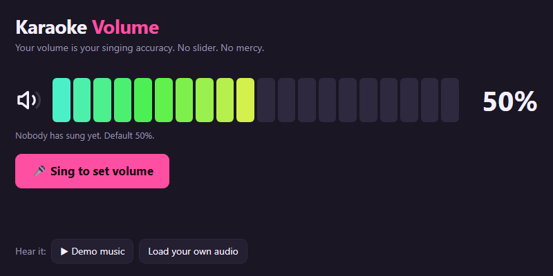

# Karaoke Volume

Your volume is your singing accuracy. Pick a song, sing a 30-second clip into your mic, and whatever percentage you hit becomes the volume. No slider. No mercy.

## what it is

A volume bar you can't click or drag. The only way to change it is to sing karaoke. Your pitch is tracked live against the melody, and your accuracy score *is* the new volume.

## what input it collects

A volume from 0 to 100%. It's miserable because:

- you have to sing for it, out loud, for 30 seconds
- being in tune within half a semitone gets full credit; 1¾ semitones off gets nothing
- if you want 37%, good luck being exactly 37% good
- clicking the bar just makes it shake at you

Songs: six public-domain classics built in, or write your own (notes + lyrics), or load any audio file and the melody gets extracted (works best with isolated vocals). Any octave counts. Everything runs in the browser: no servers, no paid APIs, and the mic audio never leaves your computer.

## screenshot

## live

https://dariuspipin.github.io/evil-volume/

## how to run it

open `index.html` in a browser (Chrome or Edge) and allow the microphone. headphones recommended, otherwise the mic hears the guide melody.
